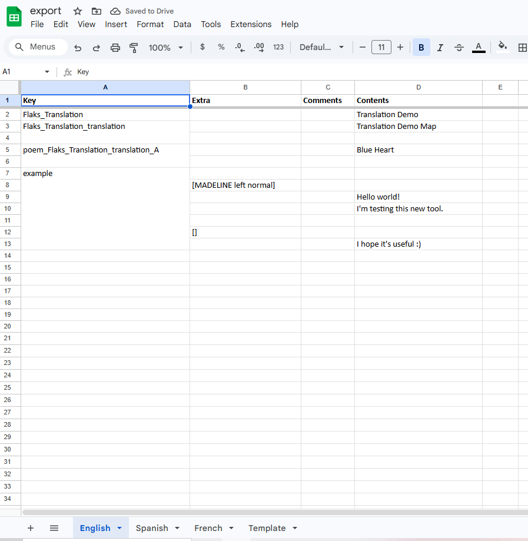
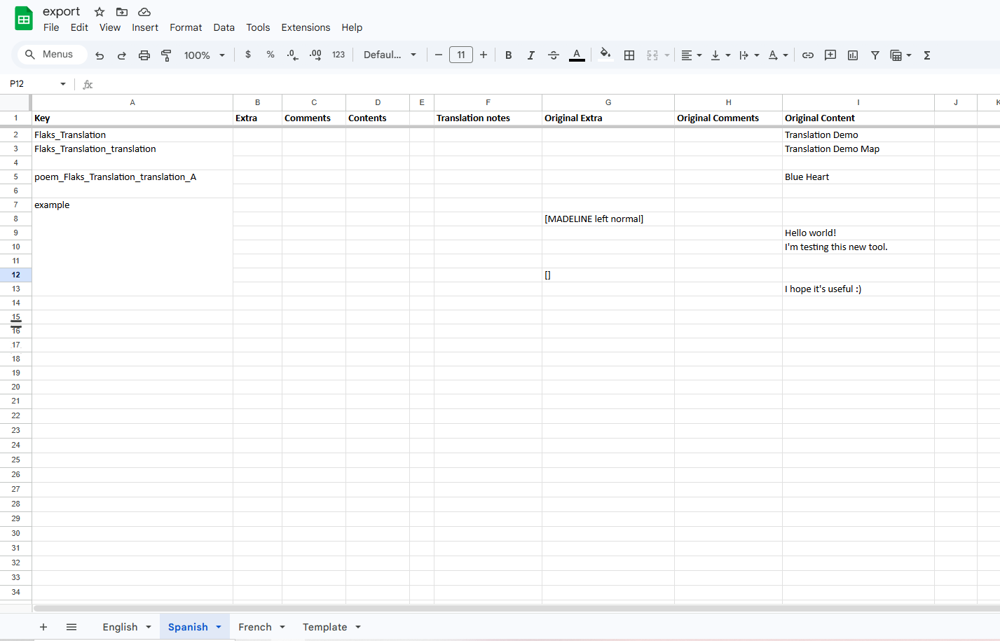
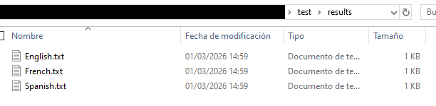

# Celeste-Translation-Tool
Tool for Celeste mods to convert `English.txt` (or any `<Language>.txt`, including multiple languages) into a spreadsheet and back.

---

# Installation
**Python 3.14 or higher is required.**
Install the project dependencies with this command:
```bash
# Linux/macOS
python3 -m pip install -r requirements.txt

# Windows
py -3 -m pip install -r requirements.txt
```

# Usage
Run `main.py` to access terminal commands:
```bash
# Linux/macOS
python3 main.py

# Windows
py -3 main.py
```

### Commands
- `0`: Exit the application.

---

- `1`: Convert multiple TXT files into an XLSX spreadsheet, including additional languages.
```
What languages would you want to add? Write them separated by commas (no spaces, unless the language name has one) and capitalized
>>> <Language A>,<Language B>,<Language C>,...,<Language Z>
Type the path to the TXT files
>>> <your/path/to/txts/>
Type the output folder
>>> <your/path/to/output>
```

You can then open the XLSX in any spreadsheet editor (including online tools like Google Sheets) to allow multiple collaborators to work on translations simultaneously.

<div>
  
</div>

A `Template` sheet is included.
**It's highly recommended to keep this sheet**, since it will be ignored when converting back, and more languages could be added if this sheet is copied.
For the added languages, the spreadsheet will look like this:
<div>
  
</div>

---

- `2`: Convert an XLSX spreadsheet back into multiple TXT files for the different languages.
```
Type the pathfile to the XLSX (NOTE: Include the name of the file and extension too, like ./import.xlsx)
>>> <path/to/import.xlsx>
Type the output folder for the TXT
>>> <your/path/to/output/>
```

If formatted correctly, it will generate the TXT files properly. You can then drag them to `Mods/yourmod/Dialog/`.
<div>
  
</div>

### Notes
1. `"Extra"` is reserved for portraits in Celeste. The line starts with `[` and ends with `]`, for example, `[MADELINE left normal]`.
2. `"Comments"` is for the comments inside the TXT, started with a `#`.
3. During the conversion of TXT to XLSX, missing keys in other languages will be put in the others. This is to ensure every key gets translated.
4. Other languages aside from English.txt can be used as the generic! Even multiple TXT can make a single XLSX.
5. In the added languages, any original item or translation note is lost after turning them into TXT again. Make sure to back up regularly! 
